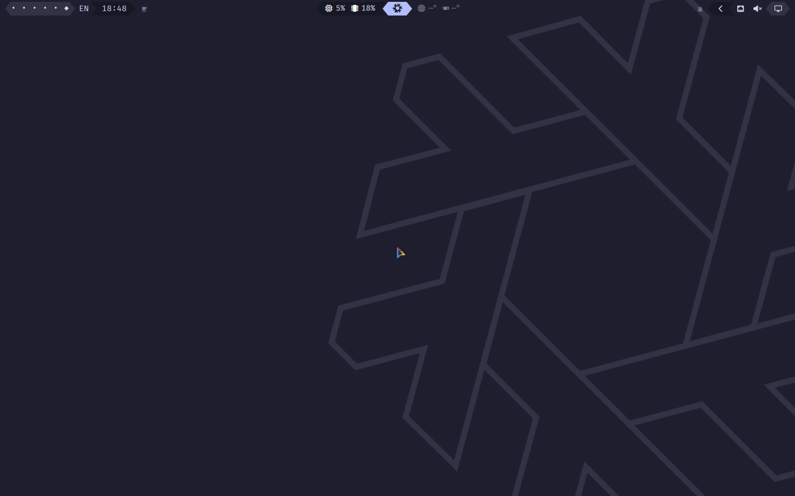
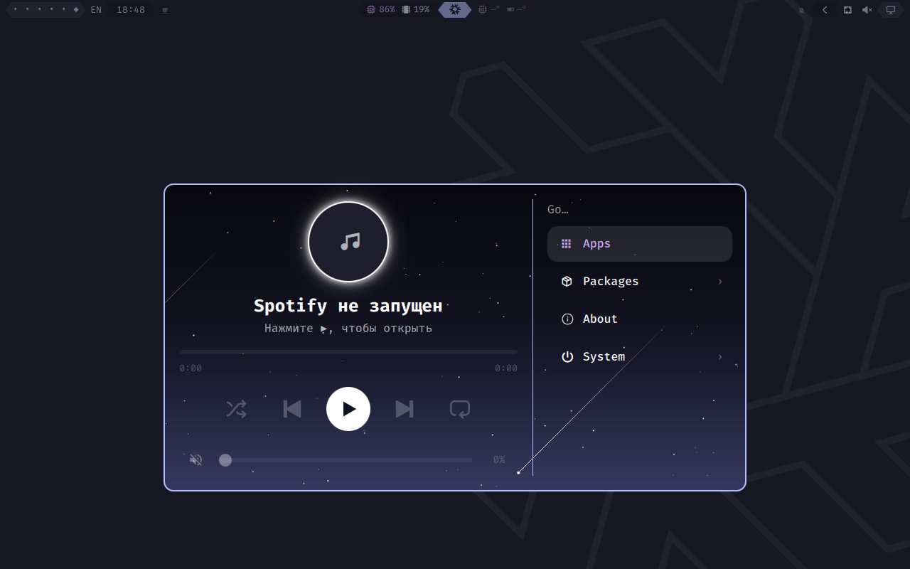
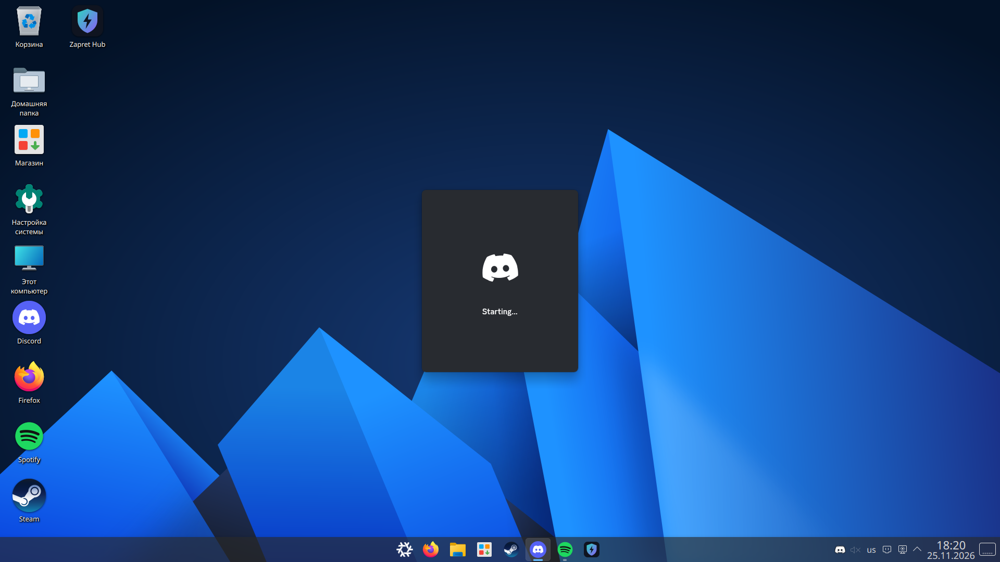

# nixos-r-hypr-Next

Рабочий стол **Hyprland** с оболочкой на Quickshell — бар, меню, плеер, темы, обои — для **NixOS**.
Ставится одной командой поверх вашей NixOS.





## Установка одной командой

На установленной NixOS, от своего пользователя (не root):

```sh
nix --extra-experimental-features 'nix-command flakes' run github:nextagg-zxc/nixos-r-hypr-Next#install
```

Что сделает установщик:

1. Положит в `/etc/nixos` файл `flake.nix` — ваша `configuration.nix` не меняется, флейк просто добавляет к ней
   Hyprland и оболочку для вашего пользователя.
2. Пересоберёт систему (`nixos-rebuild switch`).

Дальше всё как обычно: `sudo nixos-rebuild switch` сам берёт этот флейк, оболочка не пропадёт.
Обновить систему и оболочку: `sudo nix flake update --flake /etc/nixos && sudo nixos-rebuild switch`.
Убрать оболочку: `sudo rm /etc/nixos/flake.nix /etc/nixos/flake.lock && sudo nixos-rebuild switch`.

После этого выйдите из сеанса и выберите при входе **Hyprland (uwsm)**.

> Система переходит на nixpkgs этого репозитория (ветка `nixos-unstable`).
> Прежняя система остаётся в меню загрузчика — если что-то не так, выберите её при загрузке.

Если ваша `/etc/nixos` уже флейк, установщик её не трогает и подсказывает, как подключить модуль сами:

```nix
inputs.nixos-r-hypr-Next.url = "github:nextagg-zxc/nixos-r-hypr-Next";
# в modules вашей nixosConfiguration:
nixos-r-hypr-Next.nixosModules.shell
{ nextagg.shell = { enable = true; user = "ваш_пользователь"; }; }
```

Если в вашей `configuration.nix` есть `<nixpkgs>` или `<home-manager/…>` (каналы) — во флейке они не работают:
замените их на модули из флейка или удалите перед установкой.

## Что внутри

- Hyprland (Lua-конфиг, uwsm), анимации, правила окон
- Бар: рабочие столы, часы, раскладка, загрузка CPU/RAM, температуры CPU/GPU (Intel, AMD, NVIDIA), трей, флешки
- Меню **Win+B**: программы, плеер (Spotify/SoundCloud), пакеты, система
- Темы и обои, уведомления, polkit, блокировка экрана
- Терминал: fastfetch, atuin, ble.sh, yazi, zoxide

## Клавиши

| Клавиши | Действие |
|---|---|
| Win+B | Меню |
| Win+T | Терминал |
| Win+R | Браузер |
| Win+Q | Закрыть окно |
| Win+F | Во весь экран |
| Win+Enter | Плавающее окно / в плитку |
| Win+P | Открепить «призрачные» окна |
| Win+1…5 | Рабочий стол |
| Win+Shift+1…5 | Перенести окно на стол |
| Win+Shift+S | Скриншот области |
| Win+V | Журнал буфера обмена |
| Win+Space | Сменить раскладку |
| Win + мышь | Перетащить окно (левая) / изменить размер (правая) |

## Для друзей — система целиком

В репозитории есть и полная система для новичков (`nixosConfigurations.share`): установщик Calamares, KDE «как Windows 11/10»,
Магазин программ, обновление с откатом, игры (Steam, Proton, Heroic), драйверы NVIDIA. Её образ ISO раздаётся отдельно.



## Авторы и лицензии

Основа рабочего стола и сторонние части — чужие проекты; лицензии лежат рядом с исходниками в `sources/`.

| Что | Автор | Лицензия |
|---|---|---|
| Рабочий стол (основа, `sources/desktop`) | [Omarchy](https://github.com/basecamp/omarchy), David Heinemeier Hansson | MIT |
| Плагины бара (`sources/plugins/*`) | авторы — в `LICENSE` каждого плагина | MIT |
| Темы drac, void (`sources/themes/*`) | Shehab Shaef, Amit | MIT |
| Темы Neovoid, Omacarchy | [RiO7MAKK3R](https://github.com/RiO7MAKK3R) | без лицензии — берутся из репозиториев автора при сборке |
| Тема Purple Moon | [Grey-007](https://github.com/Grey-007/purple-moon) | без лицензии — из репозитория автора |
| Тема Rainy Night | [atif-1402](https://github.com/atif-1402/omarchy-rainynight-theme) | без лицензии — из репозитория автора |
| Движок обоев owe | [omacom/owe](https://github.com/omacom/owe) | без лицензии — из репозитория автора |
| Zapret Hub (`sources/zapret-hub`) | — | GPL-3.0 |

Части без лицензии в этом репозитории не лежат: Nix скачивает их у авторов. При сборке названия переименовываются под NixOS (`scripts/rebrand.py`).
