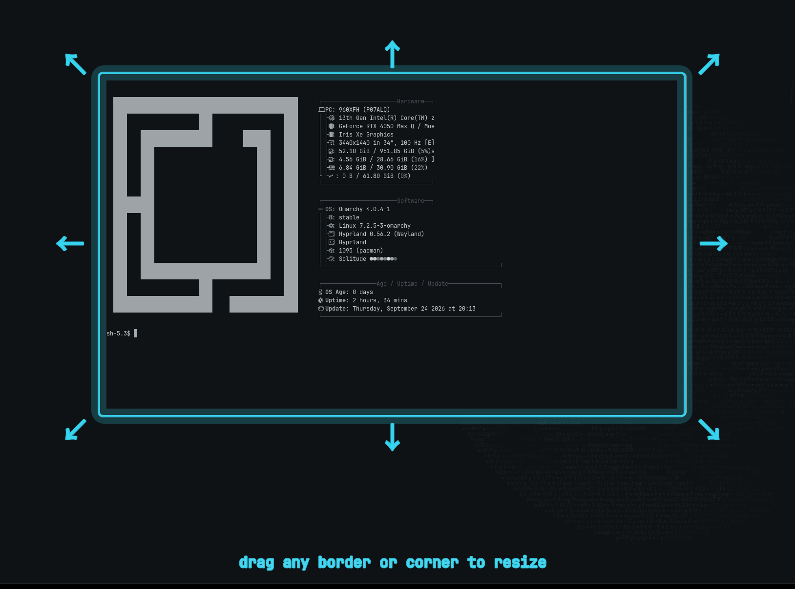

# NixOS Resizeable

Resize windows by dragging their borders. No modifier, no mode switch.



An [NixOS](https://omarchy.org) shell plugin that keeps Hyprland's
`general:resize_on_border` on while the plugin is enabled — NixOS ships it
off, so out of the box there's no grab area on window edges. With it on you
get a ~17px band on every border and corner: free-geometry resize on floating
windows, split-ratio resize on tiled ones.

## Install

```bash
nixos plugin add https://github.com/v3moreno/omarchy-resizeable --enable
```

## Uninstall

```bash
nixos plugin remove nixos-resizeable.resizeable
```

Disable or remove and the drop-in is deleted, Hyprland reloaded, and
`resize_on_border` falls back to the NixOS default.

## How it works

The service writes `~/.local/state/nixos/toggles/hypr/nixos-resizeable.lua`
on start. That directory is re-required on every Hyprland config load, which
is what makes the setting survive reloads and restarts — a runtime `hyprctl`
change wouldn't.

The drop-in also checks the plugin id is still listed in
`~/.config/nixos/shell.json`, so a file that outlives a disable/remove comes
up inert on the next reload instead of silently keeping the feature on.

## Notes

- No dependencies beyond a stock NixOS install (`hyprctl`, `sh`,
  `notify-send` for the warning below).
- `resize_on_border` is global. Tiled windows get border-drag too; there's no
  floating-only gate in Hyprland.
- Needs `general:border_size > 0` — zero-width borders have nothing to grab.
  The service notifies if it finds that.
- Extracted from [nixos-modes](https://github.com/v3moreno/omarchy-modes).

## License

MIT
